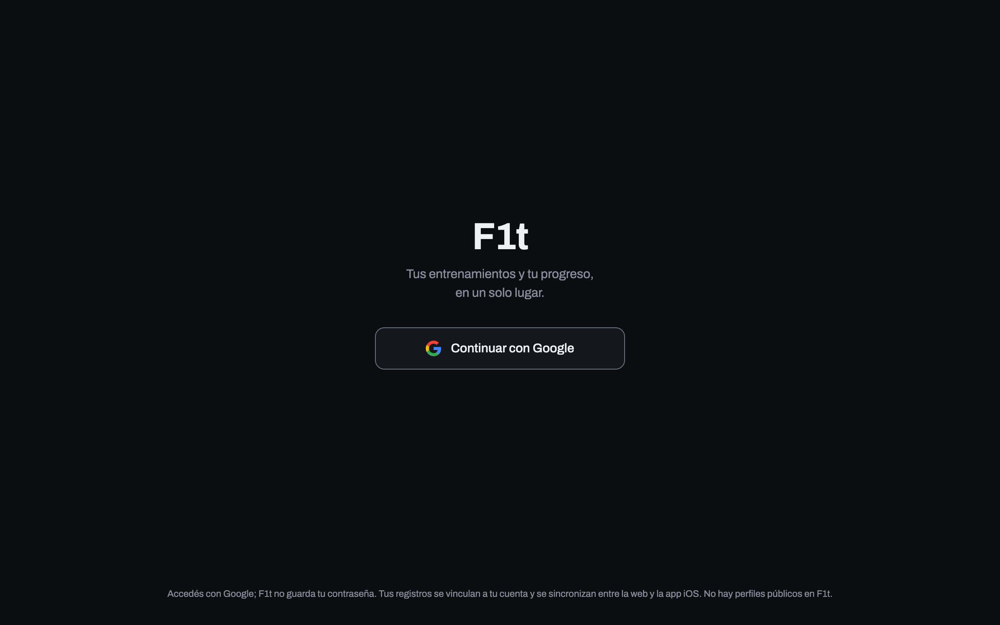

# F1t

F1t es una app de fitness para organizar rutinas y entrenamientos, consultar el calendario y seguir el progreso corporal.



## Funcionalidades

- Crear y consultar rutinas de entrenamiento.
- Registrar entrenamientos y ejercicios.
- Explorar la actividad en un calendario.
- Consultar el historial y la evolución del peso corporal.
- Ver estadísticas de actividad y evolución por ejercicio.
- Usar la app web o el cliente nativo para iOS.

## Stack

- Web: React 19, TypeScript, Vite, Tailwind CSS v4, TanStack Query y PWA.
- iOS: Swift y SwiftUI nativos (iOS 17+).
- Backend: Supabase.

## Cómo correrlo en local

### Web

Requiere Node.js y npm. Copia `.env.example` a `.env.local` y configura `VITE_SUPABASE_URL` y `VITE_SUPABASE_ANON_KEY`.

```sh
npm install
npm run dev
```

Otros scripts: `npm run build`, `npm run preview`, `npm test` y `npm run lint`.

### iOS

Requiere macOS y Xcode; el proyecto tiene deployment target iOS 17. Configura `SUPABASE_URL` y `SUPABASE_ANON_KEY` en el entorno local y ejecuta `npm run ios:prepare`, luego `npm run ios:open` para abrir `ios/App/App.xcodeproj`.
`npm run ios:build` compila para el Simulator y `npm run ios:test` corre los tests nativos.

## Estructura

- `src/`: aplicación web y lógica compartida.
- `ios/`: cliente nativo SwiftUI y proyecto Xcode.
- `supabase/`: migraciones, semillas y pruebas SQL.
- `docs/`: documentación técnica complementaria.

## Documentación

- [Cliente nativo iOS](docs/native-swift.md)
- [Base de datos y migraciones](docs/database.md)
- [Hosting web privado](docs/web-hosting.md)
- [Historial técnico](PLAN.md)

El catálogo de ejercicios deriva de [free-exercise-db](https://github.com/yuhonas/free-exercise-db) (Unlicense).
